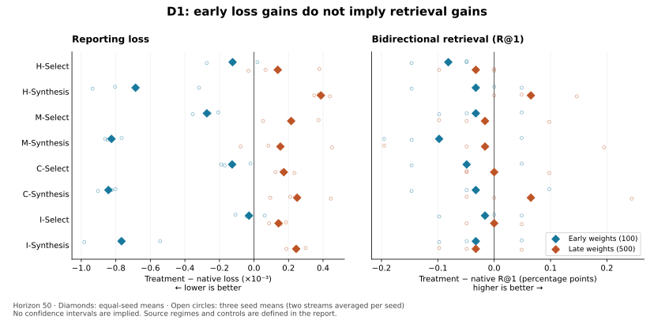

# State-Conditioned Synthetic Supervision

### When does a generated training signal help a learner?

**A living research report on synthetic-negative supervision in CLIP.**

[Read the report](docs/paper/introduction.md) · [Current progress](docs/current-progress.md) · [Research ledger](docs/experiment-ledger.md) · [Reproduce the evidence](docs/paper/reproducibility.md)

## Abstract

Image–text models learn to associate matching images and descriptions while separating nonmatching pairs. Each training minibatch provides a limited set of nonmatching examples. Combining their learned representations into synthetic negatives offers a way to expand and control these comparisons without collecting new image–text pairs. Whether these additional comparisons help—and when during training they help—requires testing. We investigate this using CLIP, a pretrained image–text model, on a bird image–caption dataset. We create synthetic negatives by combining image embeddings, then compare copies of the model trained with and without these additional negatives from the same starting point.

In our main comparison, all eight tested treatments improve average evaluation loss when introduced early in fine-tuning and worsen it when introduced later, measured after 50 further updates across three training seeds. Combining two source embeddings also outperforms using a single real negative early across all four tested source-selection rules. Related experiments show that the early–late pattern persists under controls for training history, optimizer state, learning rate, and initial intervention strength. However, the early loss improvements coincide with worse average top-1 image–text retrieval. These findings show why synthetic supervision should be evaluated for the model state and task metric it is intended to improve. They motivate selective use of generated training signals, but do not yet establish a reliable training policy or a general performance gain.

**Figure 1.** Effects relative to native training at early and late starting states. Diamonds are equal-seed means; circles are individual seed means, each averaged over two continuation streams. Lower loss and higher R@1 are preferred. Loss improvements need not imply retrieval improvements. [Results and interpretation](docs/paper/results.md) · [Exact values](docs/paper/detailed-results.md).

## Contents

| Section | What it covers |
|---|---|
| [1. Introduction](docs/paper/introduction.md) | Motivation, questions, and the scope of the contribution |
| [2. Related Work](docs/paper/related-work.md) | Recent negative-selection, curriculum, synthesis, and data-utility literature |
| [3. Problem Formulation](docs/paper/formulation.md) | Conditional utility, construction rules, and placement policies |
| [4. Experimental Setup](docs/paper/setup.md) | Data, matched controls, calibration, metrics, and replication units |
| [5. Results](docs/paper/results.md) | Completed findings, including negative results and retrieval discrepancies |
| [6. Discussion](docs/paper/discussion.md) | What the controls resolve and what remains unexplained |
| [7. Limitations](docs/paper/limitations.md) | Reused development data, effect sizes, generalization, and identification |
| [8. Conclusion](docs/paper/conclusion.md) | Supported conclusions and outstanding questions |
| [References](docs/paper/references.md) | Primary sources, emphasizing relevant 2024–2026 work |

### Appendices

[A. Detailed results](docs/paper/detailed-results.md) · [B. Placement validation](docs/paper/numerical-validation.md) · [C. Claim-to-evidence index](docs/paper/evidence.md) · [D. Reproducibility](docs/paper/reproducibility.md)

### Research workspace

[Current progress](docs/current-progress.md) summarizes completed and pending work. The [research ledger](docs/experiment-ledger.md) preserves the study history; the [research agenda](docs/research-program.md) describes the longer-term objective. The [Colab guide](colabs/README.md) separates current validation entry points from historical launchers.

| Location | Purpose |
|---|---|
| [Source](src/) and [CLIP training](model/clip_training.py) | Objectives, constructions, and controlled experiments |
| [Configurations](configs/) and [tests](tests/) | Protocols, references, and implementation checks |
| [Evidence archives](experiment_results/README.md) | Numerical results, audits, and historical snapshots |
| [Scripts](scripts/) | Evidence analysis and reproducible figure generation |

This is ongoing research, not a claim of conference publication. The project was formerly **OTCO**; historical paths retain that name. Optimal-transport weighting was an initial hypothesis, not an established advantage. Technical provenance and hashes are retained in the linked evidence archives.
