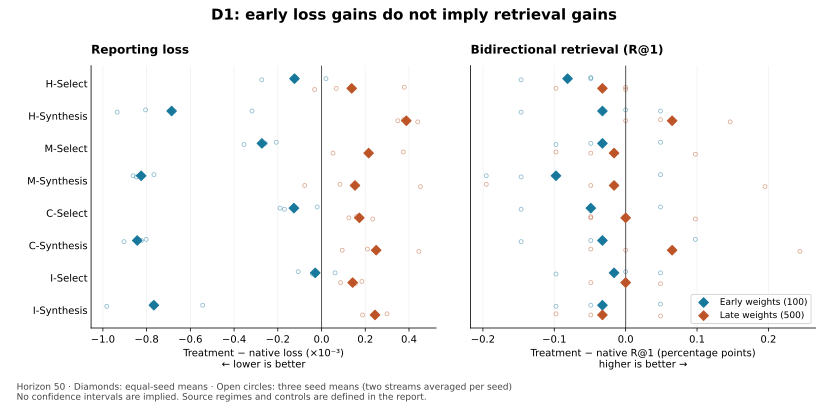

# 5. Results

[Previous](setup.md) · [Contents](../../README.md#contents) · [Next](discussion.md)

Results are organized by question. The [research ledger](../experiment-ledger.md) retains the complete chronology, including negative, partial, and replay studies.

## 5.1 Does utility depend on the tested learner state?

A consistent aggregate pattern is early reporting-loss benefit and later harm for the studied synthetic interventions. Prior auxiliary exposure is not necessary for late harm, and resetting AdamW moments and step counters does not remove it. In the weight-by-learning-rate control, the sign follows starting weights under both tested schedules:

| Starting weights | Early LR trajectory | Later LR trajectory |
|---|---:|---:|
| Update 100 | −0.00161221 | −0.00154085 |
| Update 500 | +0.00175803 | +0.00176398 |

Values are sustained-minus-native reporting loss at horizon 50. Each cell has the same sign in all six matched stream pairs. The two LR segments differ modestly, and weights encode native history; this is not evidence that LR is generally irrelevant or that representation geometry uniquely causes the effect. [Weight/LR results](../research-status-2026-10-07.md) · [History and reset evidence](../experiment-ledger.md#5-new-seeds-native-history-and-optimizer-state-controls).

## 5.2 Does difficulty explain the difference?

Semi-hard synthesis reduces late harm relative to hard synthesis, but both remain worse than native. In the difficulty study, semi-hard also has the better aggregate early H50 effect, so the primary endpoint does not support a hard-early/semi-hard-late crossover. The constructions initially exert different gradient pressures.

The subsequent pressure study calibrates hard and semi-hard constructions separately. The mean late semi-hard advantage persists, but its consistency depends on pressure:

| Intervention | Early loss Δ | Late loss Δ |
|---|---:|---:|
| Hard, 2% target | −0.00098689 | +0.00039297 |
| Semi-hard, 2% target | −0.00111003 | +0.00032365 |
| Hard, 7% target | −0.00180448 | +0.00177271 |
| Semi-hard, 7% target | −0.00231607 | +0.00108724 |

Late semi-hard wins relative to hard in all six streams at 7%, but only three at 2%. All four late aggregate effects remain harmful. Matching initial pressure does not isolate geometry or match subsequent optimizer effects. [Difficulty results](../research-status-2026-10-07-difficulty.md) · [Calibrated-pressure results](../research-status-2026-10-08-pressure.md).

## 5.3 Do source labels determine generated placement?

No. The geometry audit found that no tested support size from one to eight makes misranked-source selection available to every query. At two sources, 55.56% of continuation exposures are eligible at both starting states, motivating D1's shared mask.

At eight sources, normalized uniform mixtures of correctly ranked sources have nonpositive synthetic margins in **96.44% of early and 87.97% of late feasible exposures**. These figures are conditional on that regime's feasible population and do not compare training utility. They establish that source-side selection and generated placement must be distinguished. [Geometry results](../research-status-2026-10-09-geometry.md).

## 5.4 What does source-controlled synthesis achieve?

**Figure 1.** D1 effects after 50 updates, relative to native. Diamonds are equal-seed means; open circles are three seed means after averaging streams. Loss and retrieval have different preferred directions. The points are not confidence intervals. [Numerical tables](detailed-results.md).

All eight early aggregate loss effects improve on native, while all eight late effects worsen it. Individual seed/arm exceptions exist; these are aggregate findings.

The **prespecified primary source-side interaction is +0.000128312**, opposite the proposed relative shift toward C. Its seed effects are −0.000111748, +0.000288937, and +0.000207747. This does not establish a reliable I-early/C-late curriculum, or a reliable reverse curriculum. Its sign also changes across earlier secondary horizons; H50 remains primary.

The secondary synthesis comparison is more consistent early:

| Source regime | Early Synth − Select loss | Late Synth − Select loss |
|---|---:|---:|
| H | −0.00056197 | +0.00024982 |
| M | −0.00055218 | −0.00006239 |
| C | −0.00071655 | +0.00007697 |
| I | −0.00073797 | +0.00010246 |

Early synthesis beats the specified one-real-negative control in all four regimes for each seed average. The advantage is smaller late in every regime. Late M-Synth is relatively better than M-Select, but both are worse than native. This supports a conditional construction advantage, not intrinsic superiority of synthetic data or an established winning source regime. [Completed D1 analysis](../research-status-2026-10-16-source-complete.md).

## 5.5 Do reporting-loss gains translate to retrieval?

Not consistently. **Every early D1 arm has a negative aggregate R@1 change**, despite improved loss. Conversely, late H-Synth and C-Synth have small positive R@1 changes despite worse loss. The earlier 50-epoch CLIP ablations also did not establish a final canonical R@1 improvement over baseline. The current evidence supports state-dependent *loss* utility, not an unqualified downstream performance improvement. [D1 metric table](detailed-results.md) · [Original CLIP evaluation](../clip-experiments.md).

## 5.6 What does pressure calibration establish?

D1's 2% raw-gradient calibration was accurate, yet mean effective AdamW displacement differences at the initial probe were approximately 14.20–15.86%, falling to 0.68–0.92% near the final update. Clipping was active throughout all branches. Raw-gradient pressure and optimizer effect are distinct measurements.

The subsequent D2 numerical, gradient, and calibration stages contain **no continuation utility results**. Their purpose is to establish the execution contract for a placement experiment. See [current progress](../current-progress.md) and [Appendix B](numerical-validation.md) rather than interpreting their PASS statuses as performance gains.

---

[Previous](setup.md) · [Contents](../../README.md#contents) · [Next](discussion.md)
